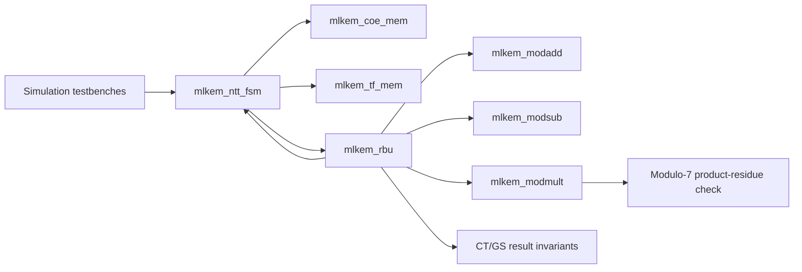

# Flex-NTT-Ext research artifact

This source snapshot packages the provided Flex-NTT-Ext RTL and its verification materials. The top-level FPGA design is `mlkem_ntt_fsm`, parameterized for 256 coefficients with modulus 3329. A separate RBU bench exercises the arithmetic modes, including degree-2 BASEMUL.

## Architecture at a glance



The controller performs forward NTT and inverse NTT butterfly scheduling with CT and GS modes. The RBU is also verified independently in CT, GS, scalar pointwise multiplication (PWM), and degree-2 BASEMUL modes. It selects arithmetic operands and uses the shared modular multiplier. The multiplier contains a two-register product/reduction pipeline and a modulo-7 residue comparison. The RBU checks the CT relation `(r0+r1) mod q = 2*a0 mod q` and the GS relation `r0 = (a0+a1) mod q` at operation completion. The controller observes the RBU fault output before entering its two coefficient-write states; if a fault is observed, it suppresses writes and ends the transform.

The RBU BASEMUL datapath implements the coefficient equations `r0 = a0*b0 + zeta*a1*b1 mod q` and `r1 = a0*b1 + a1*b0 mod q`; the supplied protocol bench checks the eight-cycle schedule. The NTT controller itself instantiates CT/GS modes; PWM and BASEMUL are RBU-level operations, not end-to-end ML-KEM polynomial multiplication in the controller.

## Reproduce

Dependencies: Icarus Verilog (`iverilog` and `vvp`) for RTL simulation, Python 3 for the two supplied Python scripts, and AMD/Xilinx Vivado for a fresh FPGA implementation run. The archived Vivado reports were generated with Vivado 2026.1. No software Python packages are required by the golden model or host fault model.

From this directory, run the test suite in PowerShell:

```powershell
powershell -ExecutionPolicy Bypass -File .\simulation\scripts\run_all.ps1
```

The script compiles and runs the arithmetic, memory, RBU, security-validation, and NTT/INTT benches. In the environment used to prepare this package, Icarus wrote each simulation image but returned a Windows access-violation code afterward; the images ran successfully. See the regression report for this compiler warning. Individual logs and compiled simulator images are placed under `simulation/logs`; the CSV summary is written to `results/regression_summary.csv`. The RBU bench includes exhaustive PWM over all `3329^2` input pairs, so it takes longer than the other benches.

Run the Python reference model and software fault model with:

```powershell
python .\simulation\scripts\golden_model.py
python .\fault_injection\source\host_security_validation.py
```

The reference model writes a JSON dump under `simulation/expected`. The fault model prints a seeded software campaign summary. It does not simulate the RTL implementation or represent a physical fault-injection experiment.

For synthesis, placement, routing, and reports, use a Vivado installation with the Artix-7 part available:

```powershell
vivado -mode batch -source .\fpga\vivado_scripts\reproduce_fpga.tcl
```

The existing XDC contains package-pin assignments and I/O delays as well as clock constraints. Confirm those pins and board-level assumptions for the intended board before reusing them. The clean script emits reports and a checkpoint under `fpga/reports/run`; it does not write a bitstream.

## Existing FPGA results

The source workspace contains Vivado report snapshots from two dates. They are kept as separate observations because their utilization differs. The 2026-10-02 timing report says timing constraints were not met (WNS `-2.801 ns`, TNS `-31.215 ns`, 12 failing endpoints). The 2026-10-23 routed timing report says constraints were met (WNS `1.629 ns`, TNS `0 ns`, no failing endpoints) at a 20 ns / 50 MHz clock. The October 23 routed utilization report records 644 Slice LUTs, 281 Slice Registers, 0.5 Block RAM Tile, and 2 DSPs. See `results/*.csv` and the sanitized source reports under `fpga/reports`.

## Integrity-validation limits

The RTL simulation demonstrates the specific injected product-register upset exercised by `tb_security_validation.v`. Its CT invariant check for an adder/subtractor upset is computed by a testbench helper on corrupted output data; that test does not inject the corruption into the RTL adder/subtractor. The GS case is a nominal invariant check, not a GS fault-injection case. The host Python campaign is a mathematical software model; its printed latency fields are constants in the script, not measured cycles. These results do not establish physical fault coverage, power/EM side-channel resistance, or complete DFA resistance.

## Double-blind and release status

The included RTL, scripts, tests, and text reports were checked for the source path, host name, waiver username, and institutional/name patterns used in the audit. Vivado text-report headers had local host/path strings removed; required Xilinx/AMD copyright notices were retained. Machine-generated Vivado projects, run scripts, caches, compiled files, bitstreams, waveforms, original presentations/PDFs, and the incomplete ASIC flow were not included. Original Git history is not included. A license has not been selected; see `LICENSE_PENDING.md`.

This is a local review package. It has not been pushed to GitHub or submitted to Anonymous GitHub. Public release remains subject to author/institution approval, redistribution-rights review, and a license choice.

## Citation placeholder

Do not use this placeholder until a real anonymous mirror exists and has been checked:

```bibtex
@misc{flexntt_artifact,
  title        = {{Flex-NTT-Ext: Design and Verification Artifacts}},
  howpublished = {Anonymous online repository},
  url          = {ANONYMOUS_REPOSITORY_URL},
  note         = {Accessed: November 2026}
}
```


